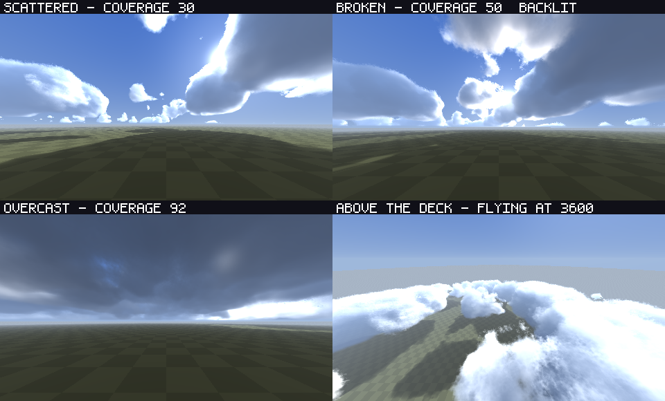
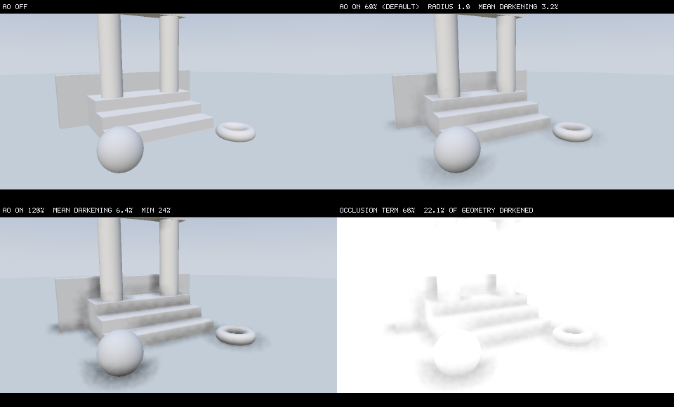
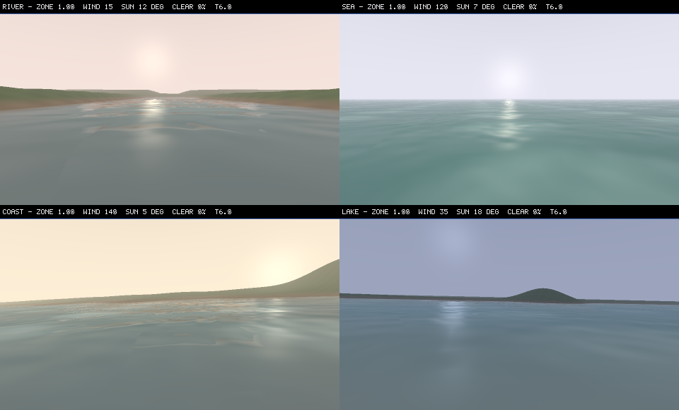
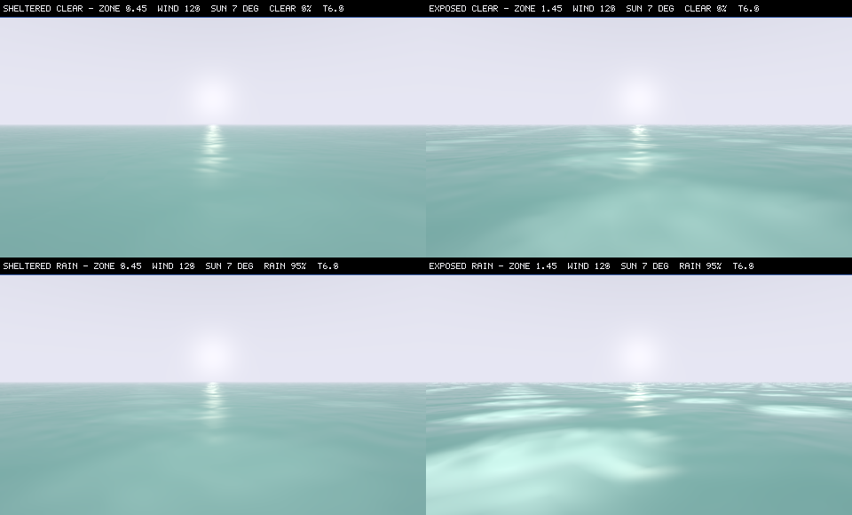

# Modern WoW Renderer

Modern WoW Renderer is a 32-bit Direct3D 9 proxy (`d3d9.dll`) that adds modern lighting, atmosphere, water, weather, and post-processing effects to the World of Warcraft client used by [Project Ascension](https://ascension.gg/).

> [!IMPORTANT]
> This project is developed and tested for the **Ascension client**. It is **not tested with a stock World of Warcraft 3.3.5 client**. The renderer is under active development, so visual glitches, compatibility problems, crashes, and performance regressions may still occur.

## Screenshots

<table>
  <tr>
    <td></td>
    <td></td>
  </tr>
  <tr>
    <td></td>
    <td></td>
  </tr>
  <tr>
    <td></td>
    <td></td>
  </tr>
  <tr>
    <td></td>
    <td></td>
  </tr>
  <tr>
    <td></td>
    <td></td>
  </tr>
  <tr>
    <td></td>
    <td></td>
  </tr>
  <tr>
    <td></td>
    <td></td>
  </tr>
</table>

## Current features

### Atmosphere and volumetric lighting

- Sun and moon god rays are a whole-frame, depth-aware gather toward the tracked celestial source: sky shows as beams, while trees, characters and buildings cast visible shadows along them and clouds break them into gaps. The math lives in `src/Effects/GodRayCore.h`; `tools/GodRayPreview.cpp` renders a reference frame and `tools/GodRayRegression.cpp` checks it.
- Height fog, aerial haze, and ground mist are integrated in world space. The animated terrain-relative local fog layer is integrated the same way but ships switched off; `Enabled=1` under `[LocalFog]` in GraphicsEffects.ini turns it on.
- When enabled, local fog follows terrain, continues to evolve while the player is standing still, and reacts to player movement with a configurable wake.
- Temporal accumulation and edge-aware upsampling reduce noise without drawing over the interface.

### Volumetric clouds

- A raymarched cloud deck replaces the flat sky: Perlin-Worley shapes placed by a weather map, lit by the tracked sun or moon, self-shadowed, and drifting with the wind.
- Eight cloud climates across 88 verified zones: fair-weather patches, sparse desert skies, coastal sheets, cold decks, mountain towers, lush billows, dark overcast and open alien skies. Unknown zones fall back safely.
- Native rain, snow and sandstorms gradually close the sky; clearing opens it again. Cloud bodies and edges evolve over time, even without wind, while shadows and rays follow the same field.
- The deck is a spherical shell, so it meets the horizon with a curve and can be flown into and above instead of being a slab pushed out of the camera's way.
- Clouds are clipped by the scene rather than drawn only on sky pixels, so the layer is still there when you fly over it and a peak inside the deck is fogged by the cloud it stands in.
- Distance hazes clouds out, the deck casts moving shadows on the world, and the layer is integrated into the scene before the atmosphere, so haze, the sun halo and god rays react to the clouds above them.
- Coverage thickens automatically while native rain or snow is falling, and the slider runs from scattered puffs to a solid overcast lid.
- Cloud-filtered sunlight forms rays through moving gaps; world-anchored ground shadows no longer change with camera height or off-screen sun tracking.
- Coverage, altitude, thickness, drift gain, haze, lighting, cloud-ray strength, independent resolution (20–100%) and a four-step **march** quality level are on F7 and in `[VolumetricClouds]`. Changing quality now actually changes steps without overriding resolution. See [docs/volumetric-clouds.md](docs/volumetric-clouds.md).



*Scattered, backlit broken, overcast and the deck from above - rendered by `tools/CloudPreview.cpp`, the CPU mirror
of the cloud shader, at the shipped defaults.*

### Dynamic environment lighting

- Trusted native point and spot lights can illuminate nearby world surfaces.
- Strong local lights contribute to volumetric scattering in fog and mist.
- Held torches and lanterns retain their light while the player briefly occludes the source from the camera.
- Screen-space occlusion and depth-derived normals keep the effect attached to visible geometry.

### Ambient occlusion

- Screen-space ambient occlusion from the captured scene depth seats objects on the ground and deepens creases, corners and cavities.
- It is the first effect applied to the scene, so it darkens world geometry only: clouds, local light, fog, glare and the interface all composite over the result untouched, and sky and water are excluded outright.
- Tuned to be felt rather than seen: at the shipped radius every open surface - floor, wall face, rooftop - keeps its brightness exactly, while a right-angled corner still darkens by a quarter. Raising `AO RADIUS` reaches further into architecture and starts darkening whole surfaces; `AO STRENGTH` alone never does.
- A depth-aware blur keeps occlusion from smearing across an object edge onto the background behind it, and the effect retires with distance instead of sparkling.
- **F7 → AMBIENT OCCLUSION** holds the switch, strength, radius, distance fade and a debug view. See [how it works and why the defaults are what they are](docs/ambient-occlusion.md).



*Off, on at the shipped defaults, on at twice the shipped strength, and the raw occlusion term - rendered by
`tools/AmbientOcclusionPreview.cpp`, which runs the same math the GPU runs over the same depth buffer.*

### Weather

- Rain uses a depth-aware field of layered, resolution-aware streaks: longer sparse foreground drops, finer distant rain, tapered highlights and scene-adaptive contrast. Gravity pulls them down, shared world wind moves them downwind, and camera movement gives the layers smoothly eased parallax without changing the wind direction. Native rain is hidden once the new pass is ready. F7 offers speed, density, length, width, opacity, wind influence, camera parallax and mask/direction debug views.
- Snow and sand retain native particles plus a small continuity layer; their native direction remains with the game.
- Weather state survives intermittent native particle batches, missing UI draws, opening F7 and returning from Alt+Tab. Clouds, wind, waves and the continuity layer all use the detected native rain/snow/sand type; the old visual-only weather hint is ignored.
- Optional rain lens droplets and subtle snow mist are available; this setting does not also retune the volumetric atmosphere.

### Shared wind

- One invisible, world-space wind drives wave direction/sea strength and cloud drift/shear; the optional camera-relative precipitation continuity layer projects that same wind onto the screen.
- Eight meteorological compass bearings (the direction wind comes from), smooth turns, time-varying gusts and native-weather response. Strength rises during rain, snow and sandstorms and eases as weather clears.
- **F7 → WIND** controls direction, strength, gusts, timing, weather response and the wave/cloud links, with an optional diagnostic HUD. It does not alter the game's native particle motion.
- Motion phases survive tuning reloads and device resets. The same state drives waves, clouds and the precipitation continuity layer.
- Nothing in the world sways with it: grass, plants, bushes and trees are drawn exactly as the client drew them. Wind here is weather, not vegetation.
- See [wind controls, conventions and validation](docs/wind-system.md).

### Water

See [water rendering, verification and troubleshooting](docs/water-rendering.md), and
[the plan for the next water pass](docs/water-forever-round2-plan.md) for what the shading
model is being moved to and which parts of it a `ps_3_0` shader can and cannot carry.

- Screen-space reflections against the pre-water scene copy, with a horizon-to-zenith sky and
  the sun or moon mirrored in it as the fallback.
- Refraction that bends the bottom further the deeper the column is, per-channel depth
  absorption with light scattering back out of the water, shoreline/crest/shoal foam, ripples,
  Schlick Fresnel response, and a sun glint that broadens as the source drops toward the horizon.
- The surface keeps the light a disc confirmed while that disc is off screen, so pitching the
  camera up above the horizon no longer takes the sun road, the mirrored disc and most of the
  sea's brightness with it in a single frame. The direction travels in world space and is
  expressed per draw, which also lights the client's own mirrored reflection pass in the camera
  it is rendered from.
- The long swell is analytic and shared with the vertex stage, so a displaced crest and the
  light on it are the same wave; only the chop fades when a pixel cannot resolve it. A mid-wave
  band between the swell and the chop carries the texture a player reads as "waves", and above
  WATER QUALITY 8 the mesh lifts it too.
- `[Water] Quality` (F7: WATER QUALITY, 0-10) is the one water setting that is a cost rather than
  a look: it trades the chop octaves, both ray marches, the mirrored emitters, the displaced mid
  wave, the foam lace and the shore back flow at once. 0 is a flat sheet, 6 is the sea that shipped
  before the slider existed, 7 is the default, 10 is everything - and no level changes what any
  other water slider means.
- Shorelines are read off the captured depth buffer as a bed slope in world yards, so the same
  shore is the same shore at any resolution and distance: a beach gets a wide swash zone with
  sheets running up it and draining back out, a rock wall gets a narrow bright contact line.
- Foam is a lace of bright filaments over dark water-filled gaps at three scales, coloured by its
  own coverage rather than painted one flat white, and it glows when a low sun is behind it.
- Waves are evaluated on a world-anchored lattice, not on a tile's texture coordinates, so
  one continuous surface is never framed by the squares of a repeated or degenerate pattern.
- Texture-signature matching covers liquid shader variants without splitting a continuous water surface.
- Per-zone sea state and live weather response: an exposed coast carries more water than a
  sheltered pond, and stronger shared wind roughens and quickens both without counting weather twice.
  Sea strength eases over `[Water] WeatherEaseSeconds`; unlinked water retains its legacy weather response. Turning sea-energy response to zero retains authored swell but does not invent wind-driven foam in calm air.
- Explicit sea states cover all 414 roots in the verified Ascension patch-M tables. This is a
  custom WotLK 3.3.5-based dataset, including Ascension and expansion-derived map IDs, not the
  stock Wrath zone catalog; the [full zone audit](docs/water-zone-profile-audit.md) documents scope.



*The four bodies the look was tuned against - rendered by `tools/WaterPreview.cpp`, the CPU mirror of the water
shader, at the shipped defaults.*



*One sea, four sea states - `build/waterpreview --matrix --scene sea --grid 2 --supersample 2`. The columns are the
sky, the rows are what the zone asks for, and every panel shares a clock and a camera, so the difference is the model.*

### Native shadows and post-processing

- Softness and strength controls enhance the client-created cascaded shadow maps. The receivers are recognised from the shader's own bytecode (it samples the four cascade slots, and the constants it adds to a UV are its kernel), so a client update that recompiles its material shaders does not silently turn the sliders off.
- Optional brightness, contrast, gamma, and sharpness post-processing.
- Native distance-fog controls remain available for compatibility with the client's own fog path.

## Known limitations

- Native-shadow enhancement only works when the Ascension client creates its own shadow maps.
- Ambient occlusion only sees what is on screen: off-screen geometry cannot occlude, contact shading is weaker than it should be where a normal is reconstructed across a crease, and occluders thinner than about a yard can be stepped over. Run it inside the atmosphere composite, so it needs `[Volume] Enabled=1`.
- Dynamic lights and weather detection rely on observed Ascension render patterns; unusual zones, spells, addons, or future client updates can expose missed cases.
- D3D9 device resets, Alt+Tab transitions, uncommon depth formats, and third-party overlays remain compatibility-sensitive. Device-loss handling pauses the effects while the device cannot draw and resumes when it is restored, but the exclusive-fullscreen and window-switch paths have not yet been verified in the Ascension client.
- This mod is in active development. Bugs are expected; include `ModernWoWRenderer.log`, the zone, and reproduction steps when reporting one.

## Controls

| Key | Action |
| --- | --- |
| `F7` | Open or close the tabbed in-game tuning menu. |
| `F9` | Capture one diagnostic frame when celestial diagnostics are enabled. |
| `F10` | Toggle weather visuals. |
| `F11` | Toggle all injected graphics effects. |
| `F12` | Reload `GraphicsEffects.ini` without restarting the client. |

`F8` captures one diagnostic frame when `[Diagnostics] Enabled=1` in
`ModernWoWRenderer.ini`. F12 reloads that section; `AutoCapture=1` captures a
frame after reload without F8. Capture status and file errors appear in
`WaterEffect.log`. This is troubleshooting only.

F7 now uses a left-hand category list: select a tab to open its related settings. Drag the title bar to move the window, or drag the bottom-right corner to resize it. Longer tabs scroll with the mouse wheel over the settings pane, the scrollbar, or the up/down buttons. The window stays on screen; its size, position, selected tab and per-tab scroll positions are retained while the client is running. Changes save automatically.

F7 saves atmospheric, lighting, water and weather settings separately for each location. The `Settings for` row has three scopes: `Entire zone`, `This subarea`, and `Global - entire game`. **Explicit Global edits take priority over subarea and zone settings everywhere**, including after changing maps or restarting. Simply opening Global does not change anything: only settings you edit become overrides. Global shows the shared baseline for untouched settings; zone/subarea editors continue to show their own values even when Global masks them.

Global overrides are saved as `[Global.<effect section>]` in `LocationGraphics.ini`, separately from the baseline in `GraphicsEffects.ini`. In Global, `CLEAR OVERRIDES` removes overrides for the selected category so saved location settings apply again; other categories and location presets are preserved. `RESET DEFAULTS` instead saves explicit defaults for every setting in the selected category. Global remains available without a verified location; zone and subarea selection require verification. The `IMAGE & COLOR (GLOBAL)` category remains shared through `GraphicsEffects.ini` in every scope, including the post-process toggle; old local color overrides are ignored.

Location presets automatically recognize the verified Ascension executable SHA-256 `e7c2a69cb86804eb9e21254b7b45c6a03e532d8b8f94451d9e0855f7535f97c6` when `[LocationProvider] ExeSHA256` is blank. Releases include `data/areas.txt`, exported from the verified client's loaded tables. Keep the `data` folder next to the DLL. Other executable versions need [environment setup and validation](docs/ENVIRONMENT-SYSTEM-RU.md) The fingerprints of a stock 3.3.5a build 12340 `wow.exe` are recorded as a comment on
`[LocationProvider]` in `EnvironmentProfiles.ini`: copying that SHA-256 into `ExeSHA256` and naming researched
RVAs is what opts that client in, because nothing is ever read from an executable the configuration has not been
told about, and F7 names the step that refused. Unknown clients keep local presets locked; global image/color
remains editable. Existing explicit client configurations are respected.

If the header says `Location unavailable`, the reason follows it on the same line: `not configured` means `EnvironmentProfiles.ini` is not next to `d3d9.dll`, `unrecognized executable` means your client build has no verified location addresses yet (its SHA-256 is recorded in `ModernWoWRenderer.log`), `ids fail area database` means `data\areas.txt` is missing or was not exported from the client you are running, and `no world frame yet` clears itself once the world is drawn. `F12` retries after you fix a file.

If F7 is locked, unresponsive, or fails to save, open F7 and reproduce the problem, then send `MenuDiagnostics.log` from the client directory with a screenshot. It records the build, executable hash, location validation, database status, viewport/client sizes, and save/render failures. It rotates at 1 MiB to `MenuDiagnostics.log.previous`. If no log exists, include `ModernWoWRenderer.log`. F12 reloads both settings and the area database; installing a new DLL requires restarting the game.

## Installation

1. Download the newest ZIP from [GitHub Releases](https://github.com/Corfirean/modern-wow-renderer/releases).
2. Extract its contents into the Ascension client directory, next to the game executable.
3. Confirm that `d3d9.dll`, `ModernWoWRenderer.ini`, `GraphicsEffects.ini`, `EnvironmentProfiles.ini`, and `LocationGraphics.ini` are in that directory. Keep the packaged `textures`, `MaterialCache`, and `data` directories beside it; `data/areas.txt` is what lets the renderer recognise the zone you are standing in.
4. Start the client normally. Use `F7` to tune the effects and `F12` after editing `GraphicsEffects.ini` or `LocationGraphics.ini` by hand.

Example layout:

```text
Ascension/
├── d3d9.dll
├── ModernWoWRenderer.ini
├── GraphicsEffects.ini
├── EnvironmentProfiles.ini
├── LocationGraphics.ini
├── data/
│   └── areas.txt
├── MaterialCache/
│   ├── local_light_manifest.json
│   └── LocalLightReview.json
└── textures/
    └── weather/
```

Remove or rename `d3d9.dll` to disable the proxy completely.

## Configuration

`ModernWoWRenderer.ini` contains proxy-wide switches, depth-capture preferences, and diagnostic controls. Most users should leave it unchanged. The dead flat `[Atmosphere]` section was removed: live fog, shafts and clouds are controlled by `GraphicsEffects.ini`, while `[Volume] Enabled=0` still intentionally disables the whole volumetric backend.

`GraphicsEffects.ini` contains the live visual settings:

| Section | Purpose |
| --- | --- |
| `[Atmosphere]` | Volumetric quality, fog density, shafts, temporal filtering, and debug views. |
| `[LocalFog]` | Terrain-relative fog height, density, flow, and player wake. Ships off; `Enabled=1` turns it on. |
| `[DynamicLighting]` | Direct local-light pools, volumetric-scattering scale, quality, smoothing and debug views. Direct pools need `[Volume] Enabled=1` but no other effect; volumetric scattering uses the active atmosphere/local-fog medium. |
| `[WeatherVisuals]` | Native-weather intensity (also used by wind/cloud/sea response), rain particle speed, density, length, width, opacity, wind influence and debug views, plus occlusion and lens droplets; rain follows `[Wind]`. Rendering off/F10 does not disable weather detection. |
| `[Wind]` | Shared eight-direction wind, strength/gust timing, weather response, wave/cloud links, continuity-layer drift and diagnostic HUD. |
| `[VolumetricClouds]` | Cloud shape, coverage, drift gain, lighting, shadows, rays and quality. |
| `[Water]` | Reflections, refraction, ripples, foam, absorption, Fresnel, glint, and how hard the zone and the weather push on all of it. |
| `[NativeShadows]` | Enhancement of the client's native shadow softness and strength. |
| `[PostProcess]` | Global enable switch, brightness, contrast, gamma, and sharpness. Always saved in `GraphicsEffects.ini`; location overrides are ignored. |
| `[DistanceFog]` | One F7 enable/distance/power control for world-edge fog in the volume compositor and its native-shader fallback; neutral reset is 100/100. |

The F7 overlay writes supported values back to `GraphicsEffects.ini`. Manual edits can be applied with `F12`.

`LocationGraphics.ini` holds the per-location overrides, and ships empty: every example in it is commented out, so it changes nothing until you fill a value in. A setting is read from the most specific scope that holds it - the subarea, then the zone, then the map, and finally the `GraphicsEffects.ini` baseline. The whole-game `[Global.<Section>]` scope sits on top of all of them, but it does not silently override a zone you have tuned: a location takes a whole-game value only where it opts in, through its own `[Map.<map>.Zone.<zone>.InheritGlobal]` section. The file documents the scope names, the sections you may use and how to find the current Map/Zone/Area IDs. F7 saves the overlay's own changes into this same file, and it rewrites the section it writes, so keep notes above the first section header.

`EnvironmentProfiles.ini` holds the authored environment table: `[Default]`, the named climates in `[Environment.<Name>]`, and the per-place multipliers in `[Map.<id>]`, `[Zone.<id>]` and `[Area.<id>]`, resolved as `Default` then `Map` then `Zone` then `Area`. It also carries the `[LocationProvider]` block that tells the renderer which client build it may read location ids from, and without a verified client and `data/areas.txt` the renderer cannot tell which zone you are in - so none of the zone settings apply.

Water uses the live `[Water] Enabled` setting above, including location overrides.
An old water `Enabled` entry in `ModernWoWRenderer.ini` is ignored; it no longer
prevents F7 from enabling water. F11 still controls the whole graphics package.

## Building locally

Requirements:

- Visual Studio 2026 with the MSVC C++ x86/x64 tools and `v145` platform toolset.
- Windows SDK and MSBuild.
- A 32-bit `Win32` build target. The Ascension client is a 32-bit D3D9 process.

Build from a Visual Studio developer PowerShell:

```powershell
msbuild ModernWoWRenderer.sln /m /p:Configuration=Release /p:Platform=Win32 /p:PlatformToolset=v145
```

The installable output is written to `build\Release\`. The post-build step copies both INI files, the local-light manifests, and weather textures alongside `d3d9.dll`.

## Continuous integration and releases

`.github/workflows/build.yml` builds Release for each pull request targeting `main` and each push to `main`. Feature-branch pushes are not built a second time alongside their PR. A manual Build run is also available for any branch; enable its `debug` option when a Debug build is needed.

Normal CI has two jobs: the Windows Release build (including shader validation, water/weather device tests, package verification and artifact upload), and the fast portable regressions on Linux. Changelog validation runs separately only when fragments or its workflow change. Tests for current renderer behavior are retained; duplicate runs and separate runner startups are removed.

Each successful Release build uploads an install-ready artifact containing:

- `d3d9.dll`
- `ModernWoWRenderer.ini`
- `GraphicsEffects.ini`
- `EnvironmentProfiles.ini` (location verification and environment configuration)
- `LocationGraphics.ini` (the per-location override file, shipped empty so it can be filled in by hand)
- required `MaterialCache` local-light manifests
- packaged weather textures

Artifacts are retained for 14 days, including PR and manual builds. Publishing a GitHub Release is separate: run the manual `Release` workflow to build, validate and publish the ZIP. Ordinary pushes do not publish releases.

## Validation

The repository includes focused regression and shader checks:

```powershell
tools\Test-DeviceHealth.cmd
tools\Test-FrameClock.cmd
tools\Test-Wind.cmd
tools\Test-Atmosphere.cmd
tools\Test-Water.cmd
tools\Test-Weather.cmd
powershell -ExecutionPolicy Bypass -File tools\ValidateShaders.ps1
```

The device-free suites (wind, clouds, water, underwater, ambient occlusion, local lighting, camera anchoring, location and settings caches, the overlay geometry and the tracked-state mirror) also build and run on any Linux/macOS machine in one command - the same battery CI runs on every commit:

```bash
tools/RunPortableRegressions.sh          # build all suites in parallel, run them
tools/RunPortableRegressions.sh --san    # every suite under ASan+UBSan as well
tools/RunPortableRegressions.sh --only water,underwater   # one suite while iterating
```

The tests cover eight-way wind/time/weather response, wind/cloud/wave phase continuity, F7 wind settings, fog-field coverage and motion, weather continuity, held-light lifetime, depth-capture policies, embedded shader compilation, the ambient-occlusion look (open surfaces untouched, contacts and corners darkened, fade with distance, blur not crossing edges), and the device-loss, frame-gap and retry rules used after Alt+Tab. Final visual verification still requires the Ascension client because these effects depend on its real draw order, shaders, textures, and device-reset behavior.

## Project structure

```text
ModernWoWRenderer.cpp        D3D9 proxy exports, hook dispatch, and frame orchestration
VolumeIntegration.h         Atmosphere and volumetric composition
WeatherVisuals.h            Wind-driven rain and snow/sand continuity rendering
WaterEffect.h               Water replacement and shading
NativeShadowDiagnostics.h   Native cascade discovery and enhancement
TuningOverlay.h             F7 in-game settings interface
src/Core/                   Shared frame state, math, and shader caches
src/D3D9/                   Camera/depth capture and render-state guards
src/Effects/                Volumetric, ambient-occlusion and local-light render passes
src/Environment/            Location profiles, shared wind and F7 controls
src/Water/                  Sea state, wave fields and integrated wind-driven motion
src/Lighting/               Trusted local-light collection and lifetime rules
src/Scene/                  Draw-call classification
src/Diagnostics/            Runtime logging, capture, and profiling
tools/                      Offline regression and shader validation tools
Screenshots/                README gallery source images
```

The proxy loads the system Direct3D 9 runtime, forwards the normal API, observes Ascension's render state, and injects its passes before the user interface. It does not replace game data files or network behavior.

## Reporting bugs

Open a GitHub issue with:

- the Ascension client build and zone;
- the effect and settings involved;
- exact reproduction steps, including whether Alt+Tab, F7, a mount, or a device reset is involved;
- `ModernWoWRenderer.log` and a screenshot or short video when available.

Reports from stock 3.3.5 clients are still useful, but that client is currently outside the tested compatibility target.
